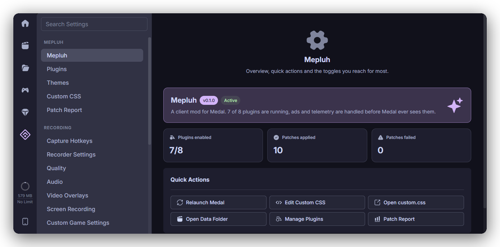

[](https://github.com/prettylittlelies/mepluh)

<p align="center"><b>A client mod for Medal. No ads, no tracking, and themes you actually want.</b></p>

<p align="center">
  <a href="https://github.com/prettylittlelies/mepluh"></a>
  <a href="https://github.com/prettylittlelies/mepluh/stargazers"></a>
  <a href="LICENSE"></a>
  <br>
  <a href="https://bun.sh"></a>
  <a href="https://www.typescriptlang.org"></a>
  <a href="https://www.electronjs.org"></a>
  <a href="#install"></a>
</p>

<p align="center">
  <a href="#features">Features</a> · <a href="#install">Install</a> · <a href="#plugins">Plugins</a> · <a href="#themes">Themes</a> · <a href="CONTRIBUTING.md">Contributing</a>
</p>

---



## Features

- 🚫 **No ads.** Every ad slot, sponsored card and promo campaign is gone.
- 🕵️ **No telemetry.** Analytics, session replay and crash reporting are blocked.
- ⚙️ **Native settings.** Mepluh lives inside Medal's own settings, built with Medal's own components.
- 🎨 **Themes.** Catppuccin, Transparency, your own `.css` files or any theme URL, applied live.
- 🫧 **Liquid Glass.** Refractive, light-reactive glass with Windows 11 Acrylic and Mica backdrops.
- ✏️ **Custom CSS.** A built-in Monaco editor with autocomplete and live preview.

## Install

Requires Windows, Medal and [Bun](https://bun.sh).

```sh
git clone https://github.com/prettylittlelies/mepluh
cd mepluh
bun install
bun run inject
```

Open Medal's settings and look for the **Mepluh** section.

Medal's updater replaces its install folder, so run `bun run inject` again after Medal updates. To remove Mepluh, run `bun run uninject`.

## Plugins

| Plugin | What it does |
| --- | --- |
| NoAds | Removes every ad slot and blocks Medal's ad session. |
| NoPromotions | Removes sponsored cards, promo announcements and campaign banners. |
| NoTelemetry | Blocks Amplitude, session replay, Sentry and LaunchDarkly uploads. |
| WindowEffects | Liquid Glass, Acrylic and Mica window backdrops. |
| CustomCSS | Applies `%APPDATA%\Mepluh\custom.css` live. |
| FeatureFlags | Overrides Medal's feature flags. |
| DevTools | Opens DevTools with F12 or Ctrl+Shift+I. |

## Themes

Drop any `.css` file into `%APPDATA%\Mepluh\themes` and enable it under **Mepluh → Themes**. Online themes work too: paste a link.

Built in: **Catppuccin** (Latte, Frappé, Macchiato, Mocha) and **Transparency**. Change the Catppuccin accent with `:root { --ctp-accent: var(--ctp-pink); }` in Custom CSS.

## License

[GPL-3.0-or-later](LICENSE)
